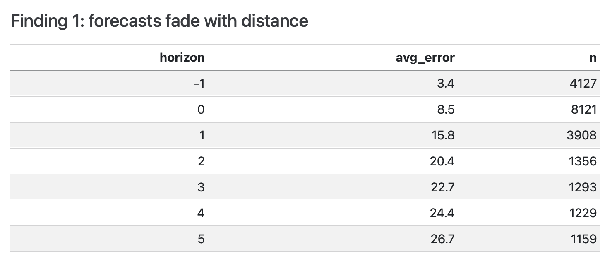
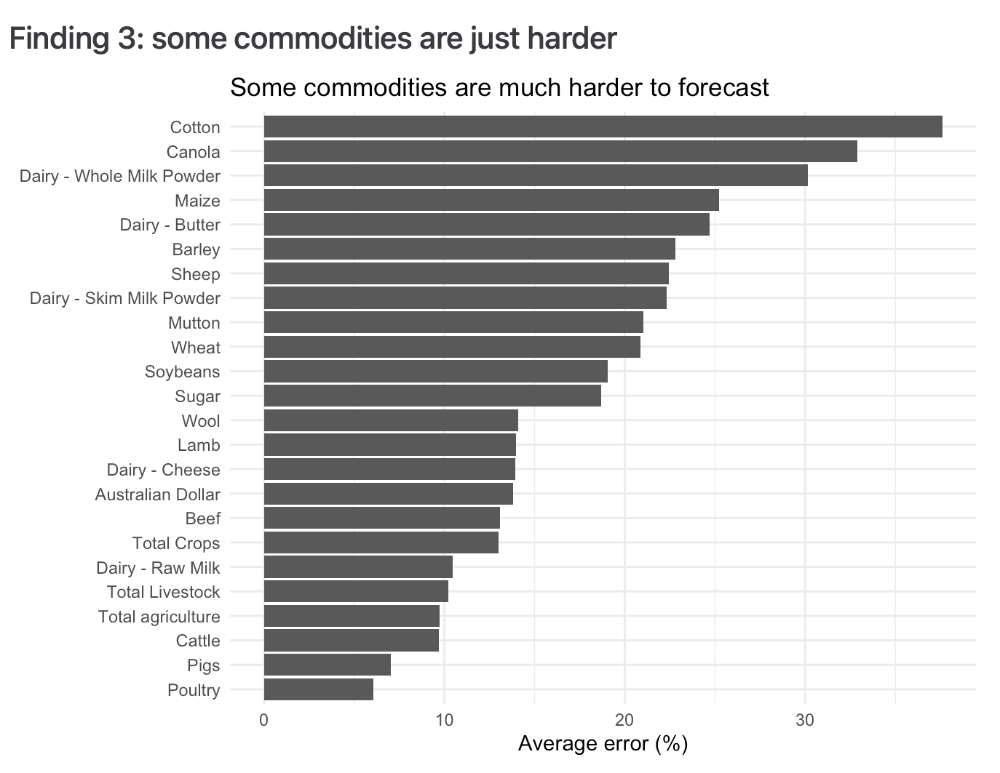
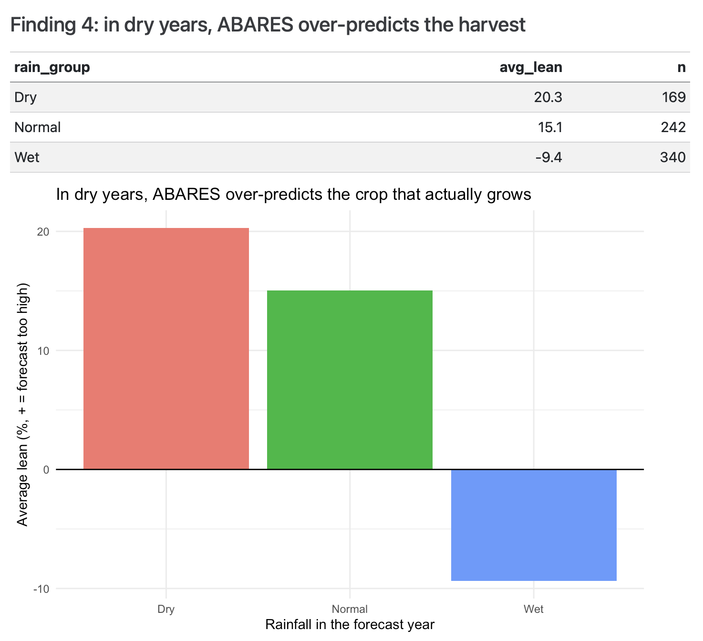

For some businesses, forecast accuracy isn't a nice-to-have. The whole operation rests on it. One bad call can cost a whole season: the prep, the buying, the planning, all built on a number that turned out wrong. So the reliance is huge, which made me wonder how much of it is actually earned.

So I spent a week asking one question about Australian farm forecasts: can you actually trust them?

## The data

ABARES, the government's farm economics agency, keeps a record of every forecast it has published since 2000, sitting right next to what actually happened [@abares2023]. That's more than 22,500 forecasts across 24 commodities, from wheat and cotton to cattle and even the Australian dollar. It's rare to get data like this, because it lets you score accuracy head-on instead of guessing at it.

I matched it against Bureau of Meteorology rainfall for each financial year to see whether the weather explained the misses. Then I found four things I didn't expect.

## 1. The further ahead you look, the worse it gets

{#fig-horizon}

@fig-horizon shows it plainly. Forecasts for the current year average about 8.5% error. Push out five years and it climbs to nearly 27%. A forecast is only as good as the assumptions behind it, and the longer you wait, the more time those assumptions have to fall apart.

## 2. "Unbiased" on average isn't the same as accurate

At first glance ABARES looks clean. Across everything, its forecasts lean just -1.1%, basically zero. Case closed, you'd think.

Except the average is doing a lot of quiet lying. Break it down by commodity and Whole Milk Powder is forecast 22% too high, cotton 10.5% too high, while maize and lamb come in around 11% too low. Opposite biases wash each other out, so the headline number hides which way each one actually leans.

## 3. Some commodities are just harder

{#fig-commodity}

@fig-commodity is where the spread becomes the whole story. Cotton (37.6%), canola (32.9%) and whole milk powder (30.2%) are the hardest to forecast. Poultry (6.1%), pigs (7.0%) and cattle (9.7%) are the easiest.

The split isn't random. Cotton and canola live and die by the season's rainfall and global prices. Poultry and pigs are raised in sheds on planned cycles, barely touched by drought. The more a commodity is at the mercy of weather and world markets, the worse the forecast gets, which matches wider research on volatile commodity markets [@zelingher2024].

## 4. The weather finding almost didn't exist

I expected dry years to make the errors bigger. They didn't. The size of the error barely moved with rainfall, and for a while I thought the whole weather angle was dead.

Then I checked the *direction* instead (@fig-rainfall).

{#fig-rainfall}

In dry years ABARES runs about 20% too high. In wet years it runs about 9% too low. The reason is timing: forecasts are locked in before the season plays out, built on a roughly normal year. A drought sinks the real harvest below the guess. A wet year pushes it past.

One honest limit: this uses national rainfall, one number for the whole continent. It can't tell a drought in one growing region from a good season in another, which is probably why the direction showed up but the size didn't.

## So, can you trust them?

It depends on which one you're holding. Lean on them for the short term. Treat long-range forecasts for weather-sensitive crops as a starting point, not a promise. The reliance is earned, but only if you know where to put it.

That rainfall pattern is also what got me thinking about climate more broadly, and eventually led to my post on the [Black Summer bushfires](../black-summer/index.qmd).

*Built in R with tidyverse and Quarto for ETC5512 at Monash. I also shared a shorter version [on LinkedIn](https://www.linkedin.com/in/anali-thiyanga-100891287).*

## References

::: {#refs}
:::
